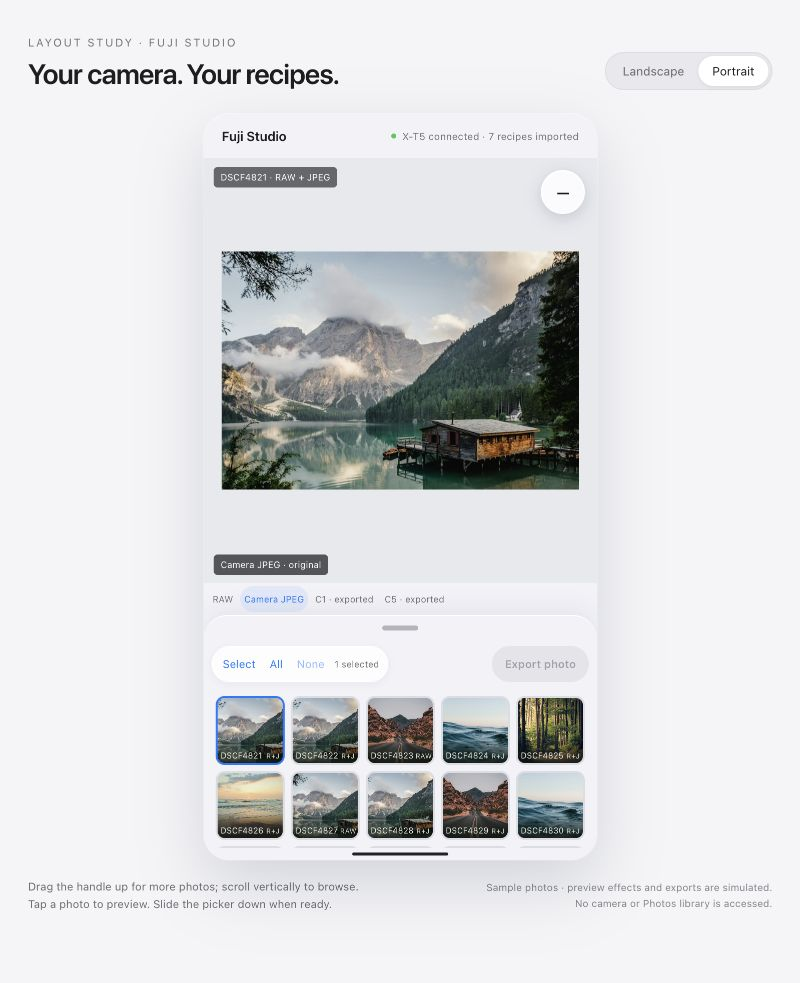

# Fuji Studio: initial product and technical specification

Date: 26 October 2026  
Status: Approved in conversation on 26 October 2026. The interface, interaction
model, and recommended initial implementation defaults below form the approved
baseline. Hardware capabilities remain subject to the feasibility gates.

Repository: [lun3x/fuji-studio](https://github.com/lun3x/fuji-studio), private.

## 1. Intent

Fuji Studio develops Fujifilm RAF photos with a USB-connected camera's own image
processor and the recipes saved in its C1–C7 custom settings slots.

The defining workflow starts in the iPhone's existing Photos library. The user
shoots RAW+JPEG, imports through an SD card reader, and sees each pair as one
Photos item. Fuji Studio must find and use that item's original RAF without
requiring the pair to be separated or imported again. Standalone RAWs work in the
same interface. A user can preview a recipe on one photo and export either that
photo or a selection of many photos.

The initial hardware target is the user's Fujifilm X-T5 and iPhone 15 Pro.

## 2. Confirmed scope

- Read existing C1–C7 recipes from the camera, including their names.
- Browse existing standalone RAF and paired RAW+JPEG Photos assets.
- Preview the selected recipe through the camera when the viewed photo changes.
- Browse the original RAW, original paired JPEG, and previous Fuji Studio exports
  as versions of the same source photo.
- Export the viewed photo outside Select mode, or a batch in Select mode.
- Create a separate Photos asset for each exported result, preserving the source
  photo's capture date and time.
- Use a vertically scrolling grid of square thumbnails in a draggable bottom
  drawer, with a two-row collapsed position and an expanded position covering
  most of the main image.
- Keep the drawer open when a photo is tapped, in both browsing and Select modes.
- Support pinch zoom in the main photo viewer.
- Use Apple's Liquid Glass design language and a floating recipe selector.

Initial non-goals:

- Creating recipes, editing their parameters, or writing recipes into C1–C7.
- Importing photos directly from the camera, SD card, or Files inside Fuji Studio.
- Developing other camera models, Apple ProRAW/DNG, or RAW+HEIF pairs.
- Additional export formats, cropping, local adjustments, filters, or retouching.
- Wireless camera communication, a desktop app, accounts, or an app-owned server.
- Cross-device catalog sync or reconstructing source/export associations after
  deleting the app. Photos' own synchronization remains independent.
- Automatically identifying JPEGs exported by other applications as versions.

Failure conditions include losing access to a pair's RAF, converting its JPEG
instead, saving previews automatically, changing the originals, changing the
camera's saved recipe values, displaying a stale render for the wrong photo, or
losing completed exports from the version list after an ordinary app restart.

## 3. Approved visual reference

[Open the self-contained interaction prototype](assets/fuji-studio-prototype.html).
It can be opened locally in a browser and needs no mockup server. The source is a
documentation artifact, not production app code. Stock photos, recipe effects,
camera connectivity, and exports are simulated.

The written behavior below is authoritative. The native app should use system
components and safe-area metrics rather than copying the prototype's CSS,
dimensions, placeholder recipes, or simulated color effects.

## 4. Interaction model

The following are separate pieces of state:

| State | Meaning |
| --- | --- |
| Viewed source | The source photo currently shown in the main viewer. |
| Displayed version | RAW, camera JPEG, a saved export, or the temporary recipe preview. |
| Selected recipe | One imported C1–C7 snapshot, or no recipe. |
| Select mode | Whether the gallery exposes batch-selection checkboxes. |
| Batch selection | Source photos checked while Select mode is active. |
| Drawer position | Collapsed, expanded, or moving between them. |
| Export job | An immutable snapshot of sources and recipe submitted to Export. |

Opening or closing the drawer does not change the recipe, viewed source, displayed
version, or batch selection. Selecting a photo does not collapse the drawer.

### Main viewer and recipe control

The photo occupies the main content area. A single floating control near its top
right displays the selected slot, for example `C3`. With no recipe selected it
shows a neutral unset symbol with an accessible “No recipe selected” label.

Tapping the control opens a menu over the viewer. The menu lists No recipe and
C1–C7, with each slot's imported name and a checkmark on the current selection.
It also provides Import/Refresh from camera. It scrolls when space is limited.
Opening it never reserves a sidebar or reduces the image's layout width.

Selecting a recipe closes the menu and requests a preview for the viewed source.
Selecting No recipe returns to the original paired JPEG when available, otherwise
the RAW display. Opening the menu, dismissing it outside, or pressing Escape
does not itself change the selection. The recipe control remains usable with the
photo drawer expanded, without covering its Export or selection controls.

### Photo drawer

The bottom drawer contains a grabber, Select/Done, All, None, the effective
selection count, Export, and the vertically scrolling thumbnail grid.

- Collapsed: the grid viewport fits two complete rows, including its padding and
  row gap. Derive the detent from actual thumbnail geometry and safe areas.
- Expanded: the drawer overlays most of the viewer and provides room for more
  rows. It does not resize or reframe the photo behind it while moving.
- Dragging the grabber moves the drawer continuously and snaps to either detent.
  A tap on the grabber and accessible Expand/Collapse actions are alternatives.
- Tapping a photo updates the viewed source. With a recipe selected, its camera
  preview is requested behind the drawer. The drawer stays at its current detent.
- After a manual collapse, scroll the grid just enough to keep the viewed source
  fully visible within the two-row viewport. Retain other selected photos.
- Thumbnail size, columns, spacing, and scroll direction remain the same when
  entering or leaving Select mode. Expansion adds visible rows, not a new layout.
- Orientation changes may recompute columns and detent heights. Preserve the
  viewed source, selections, and a sensible scroll anchor without overlaps.

Use one thumbnail for a paired RAW+JPEG asset. Give paired and standalone items a
small, readable type indicator. Exported JPEGs belong in Versions, not as duplicate
source thumbnails in this gallery.

### Browsing and selection

| Action or state | Required behavior |
| --- | --- |
| Browsing, viewed source present | That source is the single effective selection. Export can process it without first tapping Select. |
| Tap Select | Reveal checkboxes and initially check the viewed source. Preserve geometry, scroll position, and drawer detent. |
| Tap a thumbnail in Select mode | Toggle its membership and make it the viewed source. Keep the drawer open. |
| Drag to select | Add or remove a contiguous range across thumbnails and rows, with edge scrolling. |
| Tap All | Enter Select mode and select all eligible sources in the accessible gallery, including offscreen items. |
| Tap None | Clear the batch selection. It is disabled outside Select mode. |
| Tap Done | Leave Select mode. The viewed source becomes the sole effective selection. |

Recommended touch arbitration: a vertical swipe scrolls in either mode; a deliberate
selection sweep in Select mode starts across thumbnails and can continue across
rows. Once a sweep begins, approaching the grid's top or bottom scrolls the grid
while extending the range. A sweep starting on an unchecked item adds the range;
one starting on a checked item removes it. Grid gestures must not accidentally
drag the drawer; drawer resizing starts on its grabber/header drag region.

### Zoom and comparison

Pinching zooms the main photo around the gesture's focal point. The user can pan
a zoomed image within its bounds and return to fit. The initial recommended zoom
range is fit through 8 times fit; provide a double-tap fit/2-times-fit shortcut.

Keep zoom and the inspected region when switching versions or recipes on the same
source where their geometry matches. Reset to fit when viewing a different source.
Honor orientation changes and clamp panning to valid bounds. Zoom must inspect
image detail rather than merely enlarge a small gallery thumbnail.

### Appearance and accessibility

Use native Liquid Glass controls and menus, system typography, semantic colors,
and light/dark appearances. Keep the photo and thumbnail content in the content
layer. Use glass sparingly for the floating recipe control and functional chrome;
use a legible material for the text-heavy menu. Respect Reduce Transparency,
Increase Contrast, Reduce Motion, Dynamic Type, VoiceOver, and safe areas.

Selection must have a checkmark as well as a color distinction. Announce the
selected slot, displayed version, selection count, drawer position, and job
progress accessibly. All gesture actions need accessible alternatives.

## 5. Recipes

A recipe is an immutable snapshot of a C1–C7 slot's name and conversion-relevant
image settings, associated with the camera model, available device identity,
firmware, slot, and import time. Camera shooting controls unrelated to RAW
development are not applied to existing photos.

Recommended initial policy: read all seven slots when a usable camera session is
established, cache the result locally, and allow explicit refresh in the menu.
Apply a refreshed collection atomically. On a failed refresh, retain the previous
collection with a stale/error indication rather than mixing old and new slots.

Copy supported look parameters accurately, including the camera's film simulation,
white balance settings, tones, color, detail, grain, clarity, and effects where
exposed. Validate mapping against the X-T5's actual protocol and capabilities.
Retain the imported representation needed to distinguish or reject unknown values.
Do not silently substitute another film or approximate an unsupported setting.

The app never writes recipe values to C1–C7 or restores a camera backup. Protocol
selectors needed to read a bank or invoke conversion are separate from editing a
saved recipe and must be checked for side effects on hardware.

Refreshing a slot creates a new snapshot even if its display name stays the same.
Preview cache keys and export records reference the snapshot's settings identity,
not just the mutable slot number. An already submitted batch retains its snapshot.
If the selected slot is refreshed successfully, use its new snapshot for subsequent
previews and jobs and request a new current preview. Saved versions and submitted
jobs keep their original snapshots and labels.

## 6. Photos library and source resources

Request read/write Photos authorization and support both full and limited access.
With limited access, browse only authorized assets and provide the system action
for managing access. Denied/restricted access gets an actionable empty state.
Request external-camera control authorization with an accurate purpose string.

Use PhotoKit resource inspection for each candidate photo. A Photos asset can
contain both JPEG and RAW resources; `.alternatePhoto` is an example, not a
guarantee that this resource is always the RAW. Identify original RAF and JPEG
resources using their role, content type, and verified metadata. Never assume
array order or resolve a paired asset by loading only its displayed image.

The gallery has one source item per accessible asset containing an original
Fujifilm RAF. Determine camera-model compatibility from the RAF's metadata before
conversion. JPEG-only assets and other RAW formats are outside the initial source
gallery. RAWs from another Fujifilm model are shown as incompatible when detected
and cannot be submitted to the X-T5 for conversion.

Recommended ordering is capture date, newest first, with a stable identifier as a
tie-breaker. Keep selection and scroll anchors stable during library updates.
Use cached PhotoKit thumbnails and incremental discovery; browsing must not fetch
every original RAW or decode the entire library.

Resolve the original resource to a local file when needed. Resources evicted by
iCloud optimization may download through PhotoKit, with progress and cancellable
requests. A missing local file must not cause the app to treat a pair as JPEG-only.
Network failure is a retriable per-photo preparation error.

Original RAW and JPEG resources remain untouched. Existing Photos adjustments do
not replace the original RAF used for conversion.

## 7. Preview and version lifecycle

Each source has the following selectable versions:

1. **RAW:** an on-device display rendering of its original RAF, with no selected
   Fuji Studio recipe applied.
2. **Camera JPEG:** the exact original JPEG resource, when the source is a pair.
3. **Saved exports:** Photos assets previously exported by Fuji Studio from this
   source, labelled with recipe slot/name and an export time or other unambiguous
   differentiator.
4. **Recipe preview:** a temporary camera render for the active recipe, clearly
   distinguished from a saved export.

The RAW version must decode the RAF rather than present the paired JPEG as RAW.
Use Apple's RAW rendering facilities for this display. If a specific RAF cannot
be decoded locally, explain the unavailable RAW display; keep access to its
original resource, paired JPEG, and camera conversion. Local decoder support must
not determine whether the source's RAW exists.

With no recipe selected, opening a pair shows its camera JPEG; opening a standalone
RAF shows its RAW display. With a recipe selected, opening another source requests
that recipe's camera render and selects the temporary preview when ready.

Selecting RAW, Camera JPEG, or a saved export shows that version as stored and
does not reapply the selected recipe. The recipe remains the target of Export.
Changing the recipe or viewed source returns to the corresponding temporary
preview. Export always starts from the source RAF, whichever version is displayed.

Previews create no Photos asset. Cache them locally using source/resource identity,
recipe settings identity, camera/firmware context, geometry, and render quality.
Invalidate obsolete entries when source resources or relevant settings change.

Recommended first implementation: request full-resolution camera JPEGs for
previews as well as exports. Display them at an appropriate resolution and load
detail for zoom without keeping all full-size decoded images in memory. Reuse an
exact, validated full-resolution preview for export when possible. A lower-size
camera preview can never be mistaken for an export-quality result.

Coalesce rapid browsing requests. Only the latest viewed source/recipe request may
replace the main image. A late result can populate its correct cache entry but
must not overwrite a newer photo or a manually selected original/saved version.

## 8. Saved-version associations

Maintain a durable local catalog linking source Photos asset identifiers to
exported asset identifiers and immutable recipe snapshots. Save this catalog
across ordinary launches, camera reconnects, and app updates.

“Previous exports” in this version means outputs made by Fuji Studio and tracked
by its local catalog. Do not guess source relationships from equal capture dates,
similar filenames, or matching image appearance. Burst photos can share dates.

Observe Photos changes. Remove inaccessible/deleted exports from the displayed
list appropriately, invalidate missing sources, and retain unrelated completed
Photos assets. Never delete a library photo as automatic cleanup. If an original
source is removed, its exported JPEGs remain normal Photos assets even though its
RAW source group is no longer eligible for conversion.

App deletion or another device can lose the local associations. Rebuilding that
catalog and app-owned iCloud sync are outside the initial scope; this does not
remove exported photos from Photos.

## 9. Export contract

Enable Export when an effective source selection and recipe exist, the camera is
ready, and no export job is already running. Show why it is unavailable, especially
when the camera is disconnected. Browsing mode exports the viewed source; Select
mode exports exactly its checked sources.

At submission, freeze the source IDs and recipe snapshot. Process sources in a
stable order through one camera queue. Selection changes, navigation, refresh,
or later recipe changes cannot alter that job.

Recommended output policy is a full-size, FINE-quality camera JPEG using the
source's recorded aspect/crop. File format and export size are app output policy;
the imported recipe supplies the supported image-development settings. Validate
this policy against X RAW Studio and the camera; never silently substitute a
thumbnail. A full-size 3:2 X-T5 test image is 7728 by 5152 pixels.

Each successful item creates a new, independent Photos asset. Preserve the
source's effective Photos capture date/time, existing location where available,
camera output orientation, and useful camera/EXIF metadata. Prefer importing the
camera JPEG resource directly rather than decoding and re-encoding it for saving.

Preserving capture time puts the result at the same chronological position when
Photos is sorted by Date Captured. Exact adjacency among equal timestamps is
controlled by Photos. Recently Added correctly treats the output as newly added.
The app does not falsify timestamps or change originals to force ordering.

After a confirmed save, add the output to the source's Versions list and persist
the association. Keep the source thumbnail as one item. A deliberate later export
creates another version, even when the same recipe was previously used.

### Progress, cancellation, and recovery

Expose overall counts and the current item's preparation, conversion, and save
state. Offer cancellation and an end summary with completed, failed, skipped,
and cancelled/unprocessed items. Continue after an isolated file failure; pause
the job for connection/session failures affecting the remaining batch.

Cancellation stops starting new work. Complete or safely finish an in-flight USB
transaction and reconcile an in-progress Photos save before reporting its status.
Completed outputs stay saved. Retrying a job processes only failed/unprocessed
items; it does not repeat items already confirmed saved.

Persist job items and a unique export-operation ID before saving. Recommended
recovery mechanism: give each new Photos resource a filename containing that ID,
record its placeholder/local identifier when available, then confirm the durable
association after Photos reports success. After interruption, reconcile known
asset IDs or the exact operation filename before retrying an uncertain save.
If access prevents reconciliation, show an unresolved state instead of creating
another output automatically. Capture timestamps alone are not a recovery key.

Keep browsing and existing-version viewing usable during export. Export work has
priority over new camera previews; retain only the latest deferred preview.
Changing the selected recipe can affect future previews/jobs but not the active
job, whose recipe remains visible in its progress summary.

## 10. Camera session and interruptions

The X-T5 must be in USB RAW CONV./BACKUP RESTORE mode with data communication
enabled. Connection guidance should explain the camera's relevant menu settings
and a suitable USB-C data cable. The app does not silently switch camera modes.

Model connection state explicitly: disconnected, discovering, authorization
required/denied, opening session, wrong mode, ready, busy, and recoverable error.
Surface the actionable cause rather than treating every failure as “no camera.”

Use Apple's ImageCaptureCore discovery, authorization, session, and public PTP
command APIs. Serialize commands and validate response codes, transaction state,
timeouts, and returned object identity. Vendor RAW-upload and recipe-conversion
operations need a validated X-T5 implementation; desktop libusb transport cannot
simply be transplanted to an iPhone.

Disconnecting stops new camera work and pauses an export job. Keep confirmed
results, snapshots, and selections. Reconnect through a fresh valid session and
resume only after the in-flight item has been classified/reconciled. A newer
camera-slot import must not mutate the pending batch's recipe.

The initial app requires foreground operation for active USB processing. Keep the
screen awake during a foreground export and restore normal idle behavior when it
ends. On backgrounding, attempt a safe pause within the time iOS allows; suspension
can interrupt a transaction. On return, re-establish session state and reconcile
the active item. Do not promise background or locked-screen batch conversion.

Cached recipes and original/saved versions remain browseable without the camera.
Fresh recipe renders and uncached exports require it. If a requested preview cannot
be produced, retain a correctly labelled available version with a clear error;
never label an old or unmodified image as the newly requested recipe result.

## 11. Recommended architecture and considered approaches

The user selected the product workflow and approved the interaction prototype.
The following implementation approach is the approved initial baseline.

| Approach | Tradeoff and disposition |
| --- | --- |
| Native app with a PhotoKit source browser, durable catalog, and ImageCaptureCore camera service | Recommended. Direct access to paired resources and library changes supports the approved persistent drawer, version links, and batch workflow. Requires handling Photos authorization and catalog state. |
| System Photos picker feeding a separate native processing workspace | Viable if selected asset identifiers are resolved through authorized PhotoKit access. Less picker UI, but adds a separate import/selection step and still needs custom workspace, resource handling, and version tracking. Loading a picker-provided display image alone does not satisfy RAW+JPEG support. |
| Photos editing/share extension plus a companion app | Defer. A host app would still be needed for durable batch state, profile import, and USB-session management; an extension is a poor first fit for the approved library-wide selection workflow. |

Recommended baseline: Swift with a SwiftUI application shell; UIKit collection/
scroll-view integration where it improves grid gestures and zoom. Target iOS 27+
with the installed Xcode 27 SDK family. This OS baseline is an approved default,
not a statement about the phone's currently installed OS. Record the
actual phone OS before implementation; do not add older-OS compatibility paths.

Use native system materials, menus, and controls for Liquid Glass. Implement the
drawer with native detents or an in-app overlay, whichever satisfies the persistent
viewer, recipe control, gestures, and exact collapsed geometry. This mechanism is
left to the builder; user-visible behavior above is fixed.

Logical boundaries:

| Component | Responsibility |
| --- | --- |
| Library service | Authorization, incremental source discovery, original-resource access, thumbnails, and Photos changes. |
| Camera service | Device/session lifecycle, C1–C7 reads, capability validation, and serialized conversions. |
| Recipe catalog | Immutable imported snapshots and currently selected recipe. |
| Render coordinator | Current-view generations, caching, stale-result protection, and deferred preview scheduling. |
| Export coordinator | Job snapshots, sequential item processing, cancellation, and save reconciliation. |
| Persistent catalog | Source/version associations, recipe snapshots, and durable job/item status. |
| Presentation state | Viewed source/version, zoom, selection, drawer detent, and scroll anchor. |

SwiftData or a comparable local store is acceptable; exact persistence and view
composition choices are left to the builder. Use a bounded file cache for RAW
temporaries and rendered JPEGs. Keep one active RAW/conversion payload rather
than loading a batch of originals or decoded full-size images into memory.

The camera algorithm is: resolve original RAF, establish its conversion baseline,
map the selected recipe's validated look settings, request full-resolution
conversion, identify/download the generated result, and clean up only the known
temporary conversion objects. Confirm the precise upload/baseline ordering with
the protocol implementation. Never delete pre-existing camera card objects.

Use libfuji and its profile parser as protocol references or candidate dependencies.
Review licenses, pin any adopted revision, and validate X-T5 encodings. Fujifilm's
public Camera Control SDK does not provide RAW-conversion information; it is not
the assumed implementation path.

## 12. Persistent records and invariants

| Record | Minimum information |
| --- | --- |
| Source | Photos local ID, original-resource identity/content type, camera model when known, capture date/location, original version availability. |
| Recipe snapshot | Internal ID/settings hash, C1–C7 slot and name, conversion settings/raw representation, camera/firmware context, import time. |
| Saved version | Source ID, exported Photos ID, recipe snapshot ID, export-operation ID, export time, dimensions/format, save state. |
| Export job/item | Job ID, source IDs and recipe snapshot, per-item operation ID/status/error, known output/placeholder identifiers, retry/reconciliation state. |

Invariants:

- Original resources and saved camera recipe values are never overwritten.
- A paired Photos item remains one source, with its actual RAF as conversion input.
- Viewing a preview creates zero Photos assets.
- No Select mode means exactly the viewed source is the effective selection.
- Selecting sources or recipes cannot implicitly expand/collapse the drawer.
- A submitted job is independent from subsequent UI state changes.
- A render result cannot be displayed for another source, recipe, or manual version.
- An export is completed only after the Photos save is confirmed and catalogued.
- Source/version association uses explicit identity, never capture date alone.

## 13. Feasibility gates before broad implementation

The prototype proves interaction behavior only. These are hardware experiments,
not capabilities already demonstrated by this repository:

1. On the real iPhone, inspect an SD-imported RAW+JPEG asset and retrieve both its
   original RAF and original JPEG. Also check standalone RAW and limited access.
2. Discover the X-T5 in RAW-conversion mode, obtain authorization, and read all
   seven slot names/settings without altering their saved values.
3. Upload a real RAF through ImageCaptureCore and produce a full-resolution JPEG
   for two deliberately distinct recipes, then compare with X RAW Studio on the
   same camera, firmware, RAF, and settings.
4. Validate source aspect/orientation, full output dimensions, and the RAW
   compression modes actually used in the user's library. Compare decoded output
   where deterministic; grain/noise and metadata can prevent byte-identical files.
5. Save a new Photos asset with the source capture date, persist its association,
   relaunch, and display it under the correct source's Versions list.
6. Exercise disconnect, cancellation, app suspension, and an uncertain Photos save.
   Measure transfer/render latency and memory on the iPhone 15 Pro.

Failure at a gate changes the implementation investigation, not the requirement.
Report the limitation explicitly rather than replacing camera conversion with a
phone filter or dropping paired assets.

## 14. Acceptance criteria

| ID | Acceptance check |
| --- | --- |
| A01 | An SD-imported X-T5 RAW+JPEG asset appears once and its RAF can be retrieved without separating the pair. |
| A02 | Standalone RAFs and paired assets can coexist in one batch. The original primary resource choice does not hide the alternate RAW. |
| A03 | All seven imported slot names/settings are represented accurately. Refresh and conversion leave saved slot values unchanged. |
| A04 | No recipe shows the original JPEG or RAW display and disables Export. Selecting a recipe requests a temporary camera preview without saving. |
| A05 | Fast navigation and recipe changes cannot put an old render on a different photo or override a manually selected version. |
| A06 | RAW, original JPEG where present, saved exports, and temporary preview switch independently and are clearly labelled. |
| A07 | Saved versions remain associated after an ordinary app restart and camera reconnect. Two source photos with identical capture times stay distinct. |
| A08 | Outside Select mode, selecting a recipe enables export of the viewed source without another selection step. |
| A09 | Select/Done, All, None, range selection/removal, and edge scrolling obey the state table. Export is disabled for an empty batch. |
| A10 | Entering Select mode adds checkboxes without changing thumbnail sizes, columns, gaps, or scroll direction. |
| A11 | The square grid scrolls vertically with no overlapping rows, including long libraries. The collapsed viewport fits two complete rows. |
| A12 | Dragging or accessible actions expand/collapse the drawer. Expansion overlays most of the photo while preserving its underlying framing. |
| A13 | Photo taps keep the expanded drawer open in both modes and still request the selected recipe preview. Manual collapse keeps the viewed item visible. |
| A14 | Pinch zoom/pan works on the main image, with useful detail and correct version comparison. Changing source resets fit. |
| A15 | The recipe trigger shows its slot, opens a menu over content without a sidebar, and supports selection, clear, outside dismissal, and accessibility. |
| A16 | A mixed batch exports each source's original RAF using the single submitted recipe snapshot, even if UI selection or recipe later changes. |
| A17 | Exported JPEGs are full-resolution for the chosen output policy, correctly oriented, and match the camera's supported recipe output. |
| A18 | Every export creates a separate Photos asset with the original capture date. Originals and the pair remain unchanged. |
| A19 | Results sort at the source's capture time in Date Captured order; the app does not promise exact tie ordering in Photos. |
| A20 | Cancel/retry and restart recovery preserve confirmed outputs and reconcile uncertain saves before creating replacements. |
| A21 | Disconnect/wrong mode/denied authorization/iCloud download failures/storage errors have actionable states and preserve completed work. |
| A22 | Background/suspension recovery does not falsely mark an interrupted item exported. |
| A23 | Portrait, landscape, larger text, VoiceOver, reduced motion/transparency, and increased contrast preserve usable controls without overlaps. |
| A24 | Large selections do not load the entire batch into memory, block UI scrolling, or create previews as Photos assets. |

## 15. Approved defaults and builder discretion

Approved initial defaults requiring no additional product features are:

- Native Swift app, initially iOS 27+, and X-T5-only camera support.
- Full-size FINE JPEG export preserving the source's recorded geometry.
- Read/refresh C1–C7 on connection; cache immutable snapshots locally.
- Capture-date ordering, newest first, for the source gallery.
- Only Fuji Studio's locally tracked outputs appear as saved versions.
- Foreground USB operation, serial exports, cancellable/recoverable job state.
- A true RAW display can be unavailable independently of camera conversion.

The builder can choose persistence technology, native drawer/view wrappers,
thumbnail sizing within accessible targets, cache limits, and internal module/file
organization. These choices must preserve the contracts and pass the acceptance
checks. See the [implementation plan](../plans/2026-10-26-fuji-studio-implementation.md)
for delivery order, test coverage, and hardware gates. Implementation follows
review of that plan and selection of an execution approach.

## 16. Primary references

- Apple: [Photos asset resources](https://developer.apple.com/documentation/photos/phassetresource)
  and [alternate photo resources](https://developer.apple.com/documentation/photos/phassetresourcetype/alternatephoto).
- Apple: [Writing original resource data to a local file](https://developer.apple.com/documentation/photos/phassetresourcemanager/writedata(for:tofile:options:completionhandler:))
  and [iCloud resource access](https://developer.apple.com/documentation/photos/phassetresourcerequestoptions/isnetworkaccessallowed).
- Apple: [Resource creation options and filenames](https://developer.apple.com/documentation/photos/phassetresourcecreationoptions)
  and [asset creation date](https://developer.apple.com/documentation/photos/phassetchangerequest/creationdate).
- Apple: [PTP command passthrough](https://developer.apple.com/documentation/imagecapturecore/iccameradevice/requestsendptpcommand(_:outdata:completion:)).
- Apple: [Liquid Glass materials](https://developer.apple.com/design/human-interface-guidelines/materials)
  and [adoption guidance](https://developer.apple.com/documentation/technologyoverviews/adopting-liquid-glass).
- Fujifilm: [X-T5 RAW processing setup](https://fujifilm-dsc.com/en/manual/x-t5/connections/raw/),
  [X RAW Studio workflow and model matching](https://www.fujifilm-x.com/en-us/stories/fujifilm-x-raw-studio-features-users-guide/),
  [X-T5 specifications](https://www.fujifilm-x.com/en-us/products/cameras/x-t5/specifications/),
  and [Camera Control SDK scope](https://www.fujifilm-x.com/global/camera-control-sdk/).
- Protocol references: [libfuji conversion code](https://github.com/petabyt/libfuji/blob/master/lib/fuji_usb.c)
  and [Fujifilm profile parser](https://github.com/petabyt/libfuji/tree/master/fp).

No native app build, camera conversion, or device acceptance test has been run in
this repository at the time this specification was written.
